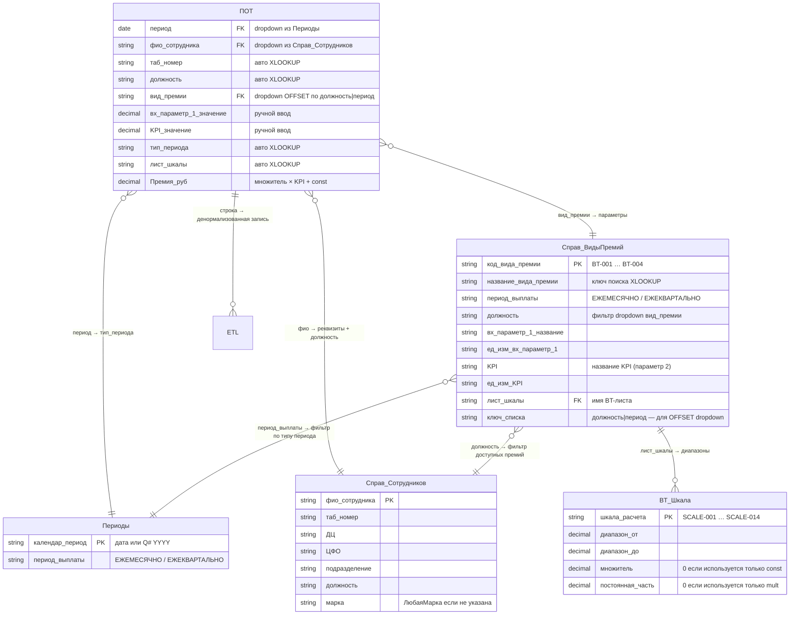

# Тестовое задание: Автоматизация расчёта переменной части ЗП

Задача — спроектировать структуру Excel-файла, в котором специалисты по компенсациям и льготам (C&B) описывают Положения по оплате труда (ПОТ) для должностей дилерских центров.

Файл используется как источник для ETL-загрузки в DWH, на основе которого рассчитывается переменная часть заработной платы каждого сотрудника.

Оригинальное задание: [ТЕСТОВОЕ ЗАДАНИЕ для Аналитика](TASK.md)

---

## Ключевое противоречие

Файл должен одновременно удовлетворять двум взаимоисключающим требованиям:

- **Удобен для бизнес-пользователя** — понятная структура, выпадающие списки, визуальная группировка
- **Машиночитаем для ETL** — плоская таблица, строгие типы, без объединённых ячеек

**Решение:** UX-лист для ручного заполнения + скрытый `ETL` лист, генерируемый автоматически. Пользователь работает с удобным форматом; ETL читает только лист `ETL`.

---

## Структура Excel-файла

```
ПОТ_прототип.xlsx
├── ПОТ                      — одна строка = один расчёт (период × сотрудник × вид премии)
├── Справ_ВидыПремий         — виды премий: период, должность, входящий параметр, KPI, ссылка на шкалу
├── Справ_Сотрудников        — реестр сотрудников: таб_номер, ДЦ, ЦФО, подразделение, должность, марка
├── Периоды                  — маппинг периодов на тип выплаты (ЕЖЕМЕСЯЧНО / ЕЖЕКВАРТАЛЬНО)
├── BT-001_Премия_КолвоАМ   — шкала за количество новых АМ
├── BT-002_Премия_КумМаржа  — шкала за кумулятивную маржу
├── BT-003_Премия_МаржаСервис — шкала за маржу сервиса
├── BT-004_Премия_КВФин     — шкала КВ от продажи финансовых услуг
└── ETL                      — плоская таблица для выгрузки в DWH (25 колонок)
```

---

## Прототип

Рабочий Excel-прототип с 9 листами. Демонстрирует механику расчёта переменной части ЗП для 4 видов премий и выгрузку плоской таблицы для ETL.

### ERD



> **BT_Шкала** — обобщённая сущность; в файле реализована четырьмя листами: `BT-001_Премия_КолвоАМ`, `BT-002_Премия_КумМаржа`, `BT-003_Премия_МаржаСервис`, `BT-004_Премия_КВФин`.

#### Описание сущностей

| Сущность | Ключ | Назначение |
|----------|------|-----------|
| **ПОТ** | — | Строка расчёта. Пользователь вводит три значения (период, сотрудник, вид премии) и до двух числовых параметров; всё остальное вычисляется формулами |
| **Периоды** | `календар_период` | Маппинг конкретной даты или квартала на тип периода выплаты (ЕЖЕМЕСЯЧНО / ЕЖЕКВАРТАЛЬНО). Тип периода участвует в фильтре dropdown вид_премии |
| **Справ_Сотрудников** | `фио_сотрудника` | Реестр из SAP HR. При выборе ФИО автоматически подтягивает таб_номер, ДЦ, ЦФО, подразделение, должность, марку. Должность участвует в фильтре вид_премии |
| **Справ_ВидыПремий** | `название_вида_премии` | Справочник видов премий. Хранит привязку к периоду и должности (для фильтрации dropdown через `ключ_списка`), названия и единицы измерения входных параметров, а также ссылку на лист шкалы |
| **BT_Шкала** | `шкала_расчета` | Таблица диапазонов. Каждая строка задаёт порог `диапазон_от`, `множитель` и `постоянная_часть`. Поиск ведётся по принципу «ближайший снизу» (match_mode = −1) |
| **ETL** | — | Денормализованная плоская таблица (25 колонок). Каждая строка ПОТ разворачивается в полную запись с кодами шкал, порогами и рассчитанной премией — готовую для загрузки в DWH |

#### Связи

| Связь | Тип | Смысл |
|-------|-----|-------|
| ПОТ → Периоды | N:1 | Период из ПОТ однозначно определяет тип выплаты |
| ПОТ → Справ_Сотрудников | N:1 | ФИО однозначно идентифицирует сотрудника и его должность |
| ПОТ → Справ_ВидыПремий | N:1 | Выбранный вид премии задаёт входные параметры и лист шкалы |
| Справ_ВидыПремий → BT_Шкала | 1:N | Один вид премии имеет несколько строк шкалы (диапазонов); шкала не переиспользуется |
| Справ_ВидыПремий → Справ_Сотрудников | N:1 | Поле `должность` в Справ_ВидыПремий ссылается на должность сотрудника — определяет, кому доступен вид премии |
| Справ_ВидыПремий → Периоды | N:1 | Поле `период_выплаты` в Справ_ВидыПремий согласуется с типом периода из Периоды — участвует в фильтрации dropdown вид_премии |
| ПОТ → ETL | 1:1 | Каждая строка ПОТ разворачивается в денормализованную запись ETL |

### Листы

| Лист | Тип | Назначение |
|------|-----|-----------|
| **ПОТ** | Ввод | Основная таблица расчёта. Пользователь заполняет период, ФИО, вид премии и числовые параметры — остальное подтягивается автоматически |
| **Справ_ВидыПремий** | Справочник | Виды премий: период выплаты, должность, названия и единицы входных параметров, ключ_списка для dropdown |
| **Справ_Сотрудников** | Справочник | Реестр сотрудников из SAP HR: таб_номер, ФИО, ДЦ, ЦФО, подразделение, должность, марка |
| **Периоды** | Справочник | Календарные периоды (даты для ежемесячных, "Q1–Q4 YYYY" для квартальных) и соответствующий тип выплаты |
| **BT-001_Премия_КолвоАМ** | Шкала | Ступени по кол-ву АМ, постоянная часть в руб. |
| **BT-002_Премия_КумМаржа** | Шкала | Ступени по кол-ву АМ, множитель на кумулятивную маржу |
| **BT-003_Премия_МаржаСервис** | Шкала | Ступени по % выполнения плана, множитель на маржу |
| **BT-004_Премия_КВФин** | Шкала | Ступени по % выполнения плана (квартальная), множитель на план КВ |
| **ETL** | Экспорт | 25 колонок: все поля ПОТ + код_шкалы, диапазоны, множитель, постоянная, премия_руб |

### Лист ПОТ: логика заполнения

Пользователь выбирает **три поля**, всё остальное заполняется автоматически:

| Колонка | Ввод | Источник |
|---------|------|----------|
| `период` | Выпадающий список | Лист **Периоды** — дата для ежемесячных, "Q# YYYY" для квартальных |
| `фио_сотрудника` | Выпадающий список | Лист **Справ_Сотрудников** |
| `таб_номер`, `ДЦ`, `ЦФО`, `подразделение`, `должность`, `марка` | Авто | XLOOKUP по ФИО из Справ_Сотрудников |
| `тип_периода` | Авто | XLOOKUP по периоду из Периоды |
| `вид_премии` | Выпадающий список | Фильтруется по должности **и** типу периода — недоступные премии не отображаются |
| `вх_параметр_1_название`, `ед_изм_1`, `KPI_название`, `KPI_ед.изм.` | Авто | XLOOKUP по виду премии из Справ_ВидыПремий |
| `вх_параметр_1_значение` | Вручную | Фактическое значение параметра 1 (количество АМ или % выполнения) |
| `KPI_значение` | Вручную (необязательно) | Фактическое значение KPI (сумма маржи или план в руб.) |
| `лист_шкалы` | Авто | XLOOKUP по виду премии из Справ_ВидыПремий |
| `Премия_руб` | Расчёт | Формула по шкале соответствующего BT-листа (см. ниже) |

> **Марка в Справ_Сотрудников:** если сотрудник работает с любой маркой — указывается значение `ЛюбаяМарка`.

### Зависимый выпадающий список вид_премии

Список видов премий фильтруется двумя условиями одновременно:

1. **Должность** — только премии, предусмотренные для должности сотрудника
2. **Тип периода** — только ежемесячные (при месячном периоде) или только квартальные (при квартальном)

Реализовано через `OFFSET + MATCH + COUNTIF` по колонке `ключ_списка` в Справ_ВидыПремий:

```excel
=OFFSET(Справ_ВидыПремий!$B$1,
  MATCH($G2&"|"&$P2, Справ_ВидыПремий!$J:$J, 0)-1,
  0,
  COUNTIF(Справ_ВидыПремий!$J:$J, $G2&"|"&$P2),
  1)
```

`ключ_списка` = `должность & "|" & период_выплаты`, например `"Менеджер по продажам новых АМ|ЕЖЕМЕСЯЧНО"`. MATCH находит первую строку с нужным ключом, COUNTIF считает сколько таких строк, OFFSET возвращает динамический диапазон названий премий из колонки B.

### Формула расчёта Премия_руб

```
Премия_руб = ROUND( множитель × KPI_значение + постоянная_часть , 2 )
```

**Шаги расчёта для строки:**

1. По `вид_премии` из `Справ_ВидыПремий` берётся `лист_шкалы` (например, `BT-001_Премия_КолвоАМ`).
2. В найденном листе ищется строка шкалы: XLOOKUP(`вх_параметр_1_значение`, колонка `диапазон_от`, match_mode = **−1**) — «точное совпадение или ближайшее снизу».
3. Из найденной строки берутся `множитель` (col E) и `постоянная_часть` (col F).
4. Применяется формула: `множитель × KPI_значение + постоянная_часть`.

**Переменные формулы:**

| Переменная | Колонка ПОТ | Смысл |
|-----------|------------|-------|
| `p1` — порог поиска | `L` (вх_параметр_1_значение) | По этому значению ищем строку в шкале |
| `p2` — KPI для умножения | `O` (KPI_значение), при пустом — `L` | На это значение умножается множитель |
| `sh` — имя листа шкалы | `R` (лист_шкалы) | INDIRECT-ссылка на BT-лист |
| `mult` | BT-лист, col E | Множитель из строки шкалы |
| `const` | BT-лист, col F | Постоянная часть из строки шкалы |

**Примеры:**

| Вид премии | p1 (кол-во АМ) | mult | const | p2 (маржа, руб.) | Премия_руб |
|-----------|---------------|------|-------|-----------------|-----------|
| BT-001, 4 АМ | 4 | 0 | 10 000 | — | **10 000 ₽** |
| BT-001, 7 АМ | 7 | 0 | 15 000 | — | **15 000 ₽** |
| BT-002, 7 АМ | 7 | 0.04 | 0 | 500 000 | **20 000 ₽** |
| BT-003, выполнение 95% | 95 | 1 | 0 | 300 000 | **300 000 ₽** |
| BT-003, выполнение 130% | 130 | 1.2 | 0 | 300 000 | **360 000 ₽** |

**Excel-формула (столбец Q):**

```excel
=IF(OR(ISBLANK(I2), R2="", ISBLANK(L2)), "",
  ROUND(
    IFERROR(XLOOKUP(L2, INDIRECT("'"&R2&"'!$C:$C"), INDIRECT("'"&R2&"'!$E:$E"), 0, -1), 0)
    * IF(ISBLANK(O2), L2, O2)
    + IFERROR(XLOOKUP(L2, INDIRECT("'"&R2&"'!$C:$C"), INDIRECT("'"&R2&"'!$F:$F"), 0, -1), 0),
  2))
```

> `match_mode = -1` означает «точное или ближайшее меньшее» — стандартное поведение шкалы с нижними границами диапазонов.

### Шкалы (листы BT-001–BT-004)

Каждый лист: одна строка = один диапазон шкалы.

| Лист | Диапазон | Множитель | Постоянная |
|------|---------|-----------|-----------|
| BT-001 | 0–2 АМ | 0 | 0 |
| BT-001 | 3–5 АМ | 0 | 10 000 ₽ |
| BT-001 | 6–15 АМ | 0 | 15 000 ₽ |
| BT-001 | 15+ АМ | 0 | 17 000 ₽ |
| BT-002 | 0–2 АМ | 0 | 0 |
| BT-002 | 3–5 АМ | 0.02 | 0 |
| BT-002 | 6–15 АМ | 0.04 | 0 |
| BT-002 | 15+ АМ | 0.05 | 0 |
| BT-003 | 0–80% | 0 | 0 |
| BT-003 | 80–120% | 1 | 0 |
| BT-003 | 120%+ | 1.2 | 0 |
| BT-004 | 0–80% | 0.5 | 0 |
| BT-004 | 80–120% | 1 | 0 |
| BT-004 | 120%+ | 1.2 | 0 |

### Верификационные тесты

Тесты проверяют сквозную логику: выбор сотрудника → фильтр вид_премии → поиск по шкале → расчёт премии.

| № | Сотрудник | Период | Вид премии | p1 | p2 (KPI) | Должность | Шкала | Mult | Const | Премия_руб |
|---|-----------|--------|-----------|----|---------|---------|----|------|-------|-----------|
| 1 | Иванов А.П. | Сент 2026 | Премия за кол-во новых АМ | 10 АМ | — | МПновАМ | SCALE-003 (6–15) | 0 | 15 000 | **15 000 ₽** |
| 2 | Петров И.В. | Q3 2026 | Поквартальная премия от прод. фин. услуг | 100% | 50 000 | МКиС | SCALE-013 (80–120) | 1 | 0 | **50 000 ₽** |
| 3 | Петров И.В. | Q3 2026 | Поквартальная премия от прод. фин. услуг | 120% | 50 000 | МКиС | SCALE-014 (120+) | 1.2 | 0 | **60 000 ₽** |
| 4 | Лебедев К.Ю. | Q3 2026 | Поквартальная премия от прод. фин. услуг | 76% | 50 000 | МКиС | SCALE-012 (0–80) | 0.5 | 0 | **25 000 ₽** |
| 5 | Смирнова Е.С. | Нояб 2026 | Премия за кол-во новых АМ | 30 АМ | — | МПновАМ | SCALE-004 (15+) | 0 | 17 000 | **17 000 ₽** |
| 6 | Морозова А.П. | Дек 2026 | Премия за маржу сервиса | 140% | 800 000 | МастерКонс | SCALE-011 (120+) | 1.2 | 0 | **960 000 ₽** |
| 7 | Иванов А.П. | Окт 2026 | Премия за кумулятивную маржу | 12 АМ | 12 000 000 | МПновАМ | SCALE-007 (6–15) | 0.04 | 0 | **480 000 ₽** |

Тесты 3 и 4 проверяют **граничные значения** шкалы BT-004: 120% попадает в диапазон 120+ (mult=1.2), а не в 80–120 — XLOOKUP с `match_mode=-1` берёт точное совпадение. Тесты 1 и 5 проверяют BT-001: mult=0 для всех диапазонов, KPI_значение не влияет на результат.


---

## Открытые вопросы

До финализации структуры необходимо уточнить у C&B:

- Тип шкалы — ретроактивная или ступенчатая? Прототип реализует ретроактивную (весь KPI × множитель диапазона), но бизнес-решение не подтверждено.
- Нужна ли история версий ПОТ (`valid_from` / `valid_to`) или только актуальная запись?
- ПОТ одинаков для всех ДЦ или может различаться по дилерскому центру?
- ПОТ одинаков для всех брендов или может различаться по бренду?
- Как часто обновляются шкалы (BT-листы)? Раз в год, квартал, ситуативно?
- Планируется ли добавление новых видов премий? Если да — кто и по какому процессу добавляет строку в Справ_ВидыПремий и новый BT-лист?

