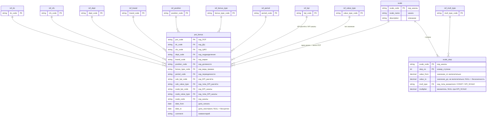

# Тестовое задание: структура Excel-файла ПОТ
 
Задача: спроектировать Excel-файл, в котором специалисты C&B описывают **Положение по оплате труда (ПОТ)**: набор премий переменной части ЗП и правила их расчёта.

Файл — источник справочника ПОТ в Хранилище данных (DWH). Расчёт премии сотруднику выполняет DWH по своим плановым и фактическим значениям KPI.
 
Оригинальное задание: [Тестовое задание для аналитика](TASK.md)
 
---
 
## Результат
 
| Файл | Роль |
|---|---|
| [`ПОТ_шаблон.xlsx`](ПОТ_шаблон.xlsx) | **Основной результат.** Шаблон для C&B и источник для ETL. |
| [`ПОТ_прототип_расчёта.xlsx`](ПОТ_прототип_расчёта.xlsx) | Вспомогательный прототип: расчёт премии по сотрудникам в Excel. Показывает механику расчёта. Не является справочником ПОТ и не загружается в DWH. |
 
---
 
## Как выполнены два требования
 
Требования не противоречат друг другу. Файл состоит из **плоских именованных таблиц Excel** (ListObject). Пользователь работает прямо в них, ETL читает их же.
 
| Требование | Решение |
|---|---|
| **Удобство для бизнес-пользователя** | Выпадающие списки по названиям; коды подставляются автоматически (столбцы с кодами скрыты). Жёлтые ячейки — ввод, серые — авто. Проверка каждой строки (столбец «проверка»: «ОК» или текст ошибки). Лист «Проверки» с итогом «Файл готов к загрузке: ДА / НЕТ». Лист «Инструкция» и лист «Описание_полей». |
| **Машиночитаемость для ETL** | Одна таблица = одна сущность DWH. Связи — по кодам, не по названиям. Нет объединённых ячеек и пустых строк внутри таблиц. Все шкалы — в одной таблице, а не на отдельных листах. Строгие типы: даты — даты, проценты — доли (0,8 = 80 %). Вычисленные коды сохранены в файле (cached values) и читаются без Excel. |
 
---
 
## Ключ ПОТ
 
По заданию набор премий определяется сочетанием атрибутов сотрудника:
 
**ДЦ + ЦФО + подразделение + марка + должность**
 
Одна строка ПОТ = одна премия для одного сочетания на период действия (`дата_начала` … `дата_окончания`).
Если марка не определена, то это отдельное значение справочника "ЛюбаяМарка" (у подразделения нет профильной марки).
 
---
 
## Формула расчёта
 
```
Премия = значение KPI_расчёта × Множитель
```
 
1. DWH берёт значение **KPI_шкалы** (X) нужного типа: факт, план или % выполнения.
2. DWH находит ступень шкалы: `значение_от ≤ X < значение_до` (пустое `значение_до` = без верхней границы).
3. Множитель:
   - тип `CONST` («Число») — значение из ступени;
   - тип `KPI_SCALE` («Значение KPI шкалы») — множитель = X (так задаётся «от 80 % до 120 % — % выполнения плана»).
4. Премия = значение **KPI_расчёта** × множитель.
5. Переменная часть ЗП = сумма премий сотрудника за период.
**KPI_расчёта** и **KPI_шкалы** — разные поля. Так покрываются все варианты из задания: «маржа × множитель по кол-ву АМ», «плановая премия × множитель по % выполнения» и т.д.
 
### Примеры (по условиям задания)
 
| Премия | KPI_расчёта | KPI_шкалы (X) | Ступень → множитель | Премия |
|---|---|---|---|---|
| За количество новых АМ | Кол-во АМ, факт = 10 | Кол-во АМ, факт = 10 | 6 ≤ 10 < 15 → 15 000 | 10 × 15 000 = **150 000** |
| За количество новых АМ | Кол-во АМ, факт = 30 | Кол-во АМ, факт = 30 | ≥ 15 → 17 000 | 30 × 17 000 = **510 000** |
| За кумулятивную маржу | Кум. маржа, факт = 12 000 000 | Кол-во АМ, факт = 12 | 6 ≤ 12 < 15 → 0,04 | **480 000** |
| За маржу сервиса | Маржа сервиса, факт = 800 000 | % вып. плана маржи = 95 % | 80 % ≤ 95 % < 120 % → X = 0,95 | **760 000** |
| За маржу сервиса | Маржа сервиса, факт = 800 000 | % вып. плана маржи = 140 % | ≥ 120 % → 1,2 | **960 000** |
| За КВ фин. услуг | Плановая премия за КВ, план = 50 000 | % вып. плана КВ = 100 % | 80 % ≤ 100 % < 120 % → X = 1,0 | **50 000** |
| За КВ фин. услуг | Плановая премия за КВ, план = 50 000 | % вып. плана КВ = 120 % | ≥ 120 % → 1,2 | **60 000** |
| За КВ фин. услуг | Плановая премия за КВ, план = 50 000 | % вып. плана КВ = 76 % | 0 ≤ 76 % < 80 % → 0,5 | **25 000** |
 
Строки, кроме 95 %, проверены на листе «Пример_расчёта» шаблона.
 
---
 
## Структура файла `ПОТ_шаблон.xlsx`
 
```
ПОТ_шаблон_v2.xlsx
├── Инструкция       — правила заполнения, формула, типовые операции, сообщения проверок, контракт ETL
├── ПОТ_Премии       — [pot_bonus]   ПОТ: премия для сочетания атрибутов              ← ввод C&B, ETL
├── Описание_полей   — словарь данных: каждый столбец, тип, правило, пример
├── Справочники      — [ref_*]       10 справочников с кодами (источник — DWH / SAP HR)
├── Шкалы            — [scale]       список шкал                                      ← ввод C&B, ETL
├── Шкалы_ступени    — [scale_step]  ступени всех шкал                                ← ввод C&B, ETL
├── Проверки         — итог проверок, «Файл готов к загрузке: ДА / НЕТ»
└── Пример_расчёта   — [calc_example] демонстрация расчёта по сотрудникам (не ETL)
```
 
В квадратных скобках — имя таблицы Excel, по которому её читает ETL.
 
### ERD
 

 
Имена в ERD — технические имена DWH. В Excel столбцы названы по-русски (указаны в комментариях); соответствие зафиксировано в контракте ETL.
 
### Справочники
 
| Таблица | Содержимое | Значения в шаблоне |
|---|---|---|
| `ref_dc` | ДЦ | ДЦ Север, ДЦ Юг, ДЦ Запад |
| `ref_cfo` | ЦФО | Продажи новых АМ, Финансовые услуги, Сервис |
| `ref_dept` | Подразделения SAP HR | Отдел продаж новых АМ, Отдел кредитования и страхования, Сервисный центр |
| `ref_brand` | Марки | Не определена, Haval, Chery, Geely |
| `ref_position` | Должности | МП новых АМ, Мастер-консультант, МКиС |
| `ref_bonus_type` | Виды премий | BT-001 … BT-004 |
| `ref_kpi` | KPI | Кол-во новых АМ, Кум. маржа, Маржа сервиса, КВ фин. услуг, Премия за КВ (план) |
| `ref_period` | Периодичность | MONTH, QUARTER, YEAR |
| `ref_value_type` | Тип значения KPI | FACT, PLAN, PCT |
| `ref_mult_type` | Тип множителя | CONST, KPI_SCALE |
 
Коды в шаблоне условные. В рабочем файле — коды НСИ DWH / SAP HR. C&B справочники не меняет: новое значение — заявка в DWH.
 
### Шкалы из задания
 
Границы приведены к полуинтервалам `[от; до)` без пересечений и разрывов.
 
| Шкала | Ступени (значение_от → множитель) |
|---|---|
| SC-001 Кол-во новых АМ → сумма за 1 АМ | 0 → 0; 3 → 10 000; 6 → 15 000; 15 → 17 000 |
| SC-002 Кол-во новых АМ → доля кум. маржи | 0 → 0; 3 → 0,02; 6 → 0,04; 15 → 0,05 |
| SC-003 % вып. плана маржи сервиса | 0 → 0; 80 % → **= X**; 120 % → 1,2 |
| SC-004 % вып. плана КВ фин. услуг | 0 → 0,5; 80 % → **= X**; 120 % → 1,2 |
 
---
 
## Контракт ETL
 
ETL читает **именованные таблицы Excel**, не листы и не диапазоны. Загрузка — только при «Проверки» = «ДА». Столбцы с названиями и столбец «проверка» не загружаются.
 
| Таблица | Ключ | Загружаемые столбцы | Целевая сущность DWH |
|---|---|---|---|
| `pot_bonus` | `код_ПОТ` | код_ПОТ, код_ДЦ, код_ЦФО, код_подразделения, код_марки, код_должности, код_вида_премии, код_периодичности, код_KPI_расчёта, код_типа_KPI_расчёта, код_KPI_шкалы, код_типа_KPI_шкалы, код_шкалы, дата_начала, дата_окончания, комментарий | Справочник ПОТ, SCD2 по датам |
| `scale` | `код_шкалы` | код_шкалы, шкала, описание | Справочник шкал |
| `scale_step` | `код_шкалы` + `номер_ступени` | код_шкалы, номер_ступени, значение_от, значение_до, код_типа_множителя, множитель | Ступени шкал |
| `ref_*` | `код_*` | все | Сверка с НСИ DWH |
 
Пример чтения (pandas + openpyxl):
 
```python
from openpyxl import load_workbook
import pandas as pd
 
wb = load_workbook("ПОТ_шаблон_v2.xlsx", data_only=True)
 
def read_table(name):
    for ws in wb.worksheets:
        if name in ws.tables:
            rows = [[c.value for c in r] for r in ws[ws.tables[name].ref]]
            return pd.DataFrame(rows[1:], columns=rows[0])
 
pot_bonus  = read_table("pot_bonus")
scale_step = read_table("scale_step")
```
 
### Алгоритм расчёта в DWH
 
1. Для сотрудника на дату периода взять: код_ДЦ, код_ЦФО, код_подразделения, код_марки, код_должности.
2. Выбрать строки `pot_bonus` с этими кодами, где `дата_начала ≤ дата периода ≤ дата_окончания` (NULL = бессрочно) и `код_периодичности` = тип расчётного периода.
3. Взять значение KPI_расчёта и KPI_шкалы нужных типов (FACT / PLAN / PCT).
4. Найти ступень в `scale_step`: `значение_от ≤ X < значение_до`.
5. Множитель: CONST → `множитель`; KPI_SCALE → X.
6. Премия = KPI_расчёта × множитель. Нет значения KPI → премия не считается, запись в журнал ошибок.
7. Переменная часть ЗП = Σ премий сотрудника за период.
---
 
## Проверки в файле
 
| Таблица | Проверка |
|---|---|
| `pot_bonus` | дубль кода; пустые обязательные поля; значение не из справочника; дата окончания раньше даты начала; у шкалы нет ступеней; пересечение периодов действия для того же сочетания атрибутов и вида премии |
| `scale_step` | шкала не найдена; пустые обязательные поля; нет множителя при типе CONST; лишний множитель при KPI_SCALE; дубль номера ступени; `значение_до ≤ значение_от`; пересечение диапазонов; разрыв между ступенями |
 
---
 
## Прототип расчёта (`ПОТ_прототип_расчёта.xlsx`)
 
Первая версия решения. Одна строка — расчёт премии для сотрудника за период; шкалы — на отдельных листах BT-001 … BT-004; лист ETL — денормализованная выгрузка.
Оставлен как демонстрация механики расчёта. Как справочник ПОТ не используется, потому что:
 
- ПОТ задан по сотрудникам, а не по сочетанию ДЦ + ЦФО + подразделение + марка + должность;
- каждая шкала — отдельный лист: новая премия требует доработки ETL;
- связи построены по названиям, а не по кодам;
- лист ETL построен на формулах XLOOKUP / INDIRECT, в столбце «период» смешаны даты и текст.
---
 
## Допущения и открытые вопросы
 
| № | Вопрос | Принятое решение |
|---|---|---|
| 1 | В задании границы пересекаются: «от 6 до 15» и «от 15 и выше». | 15 относится к верхней ступени: `6 ≤ x < 15`, `x ≥ 15`. Подтвердить у бизнеса. |
| 2 | Шкала ретроактивная (весь KPI × множитель ступени) или прогрессивная (каждая часть KPI × множитель своей ступени)? | Ретроактивная — так в примерах задания. При прогрессивной добавляется тип шкалы. |
| 3 | Марка — атрибут подразделения или сотрудника? Несколько марок у сотрудника? | Марка — один атрибут сочетания. «Не определена» — отдельное значение. Если ПОТ одинаков для всех марок — обсудить значение «ВСЕ». |
| 4 | ЦФО: как связан с ДЦ? | Независимый атрибут сочетания. Уточнить у C&B. |
| 5 | Связана ли должность с подразделением? | В шаблоне не связана: сочетание задаётся явно. |
| 6 | Формат % выполнения в DWH. | Доля: 0,8 = 80 %. Если хранится как 80 — пересчитать границы шкал. |
| 7 | Периодичность ПОТ и период KPI. | Квартальная премия считается по квартальным значениям KPI. Уточнить у DWH. |
| 8 | Коды справочников. | В шаблоне условные. Заменить на коды НСИ DWH / SAP HR. |
